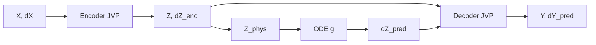

# Математика Latent AE+ODE (C++ / LibTorch)

Документ описує модель і пов’язані чисельні операції, які
реалізовані в C++ (`eegexpcpp_model`, `eegexpcpp_train`,
`eegexpcpp_infer`). Підготовку HDF5 робить Python; формули нижче
фіксують те, що потрапляє в тензори `X`, `dX` і в навчання.

## Позначення

| Символ | Значення |
|--------|----------|
| \(B\) | розмір батча (у train/val зазвичай \(B=1\)) |
| \(T\) | довжина часового вікна |
| \(F\) | `feature_dim` — розмірність ознак після delay-embedding |
| \(L\) | `n_latent` — розмірність латентного простору |
| \(\varepsilon\) | \(10^{-8}\) у z-score та масштабуванні похідної латенту |

Тензори в C++: **`[B, T, F]`** або **`[B, T, L]`** (час — вісь 1,
ознака/латент — вісь 2). У HDF5 `X`, `dX` зберігаються як
`[F, T]` і при завантаженні транспонуються.

Часовий крок з атрибута `dt` (частота `fs`, \(\Delta t = 1/f_s\)).

## Дані на вході C++

### Нормалізація та embedding (prep, до C++)

По вихідному рядку сигналу \(s_t\) (час \(t\)):

\[
\tilde{s}_t = \frac{s_t - \mu}{\sigma + \varepsilon},
\qquad
\dot{\tilde{s}}_t \approx \mathrm{diff4}(\tilde{s}, \Delta t).
\]

Delay-embedding з параметрами \(m\), \(\tau\):

\[
\mathbf{x}_t =
\bigl(\tilde{s}_t,\; \tilde{s}_{t-\tau},\; \ldots,\;
\tilde{s}_{t-(m-1)\tau}\bigr)^\top \in \mathbb{R}^{F},
\quad F = m \text{ (або злитий } F).
\]

Аналогічно формується \(\mathbf{d x}_t\) з \(\dot{\tilde{s}}\). У
групі HDF5 зберігаються скаляри \(\mu\), \(\sigma\) як `X_mean`,
`X_std` (для першої компоненти embedding / латентного каналу).

### Четвертий порядок похідної (внутрішні вузли)

Для рівномірної сітки з кроком \(\Delta t\) (реалізація
`diff4_order1`):

\[
\dot{u}_i =
\frac{-u_{i+2} + 8u_{i+1} - 8u_{i-1} + u_{i-2}}{12\,\Delta t},
\quad 2 \le i \le T-3.
\]

Кінці вікна — односторонні формули третього порядку (див. код
`python/eegexpcpp/calculus.py`).

По осі часу в батчі: \(\mathbf{X}, \mathbf{dX} \in
\mathbb{R}^{B \times T \times F}\).

## Модулі: позначення

- **Енкодер** \(E_\theta\): \(\mathbb{R}^F \to \mathbb{R}^L\) (MLP по
  кожному \(t\), загальні ваги).
- **Декодер** \(D_\phi\): \(\mathbb{R}^L \to \mathbb{R}^F\).
- **ODE** \(g_\psi\): \(\mathbb{R}^L \to \mathbb{R}^L\) — права частина
  \(\dot{\mathbf{z}} = g(\mathbf{z})\) у **фізичних** координатах
  латенту (див. нижче).

Прямий прохід `LatentAeOde::forward` для кожного \((b,t)\):

## Енкодер і декодер: primal + JVP

Замість автодиференціювання по часу використовується **явний JVP**
ланцюжка `Linear` → `gelu` / `relu` / `tanh` → … (`TimeMlp::forward_jvp`).

Для шару \(y = W x + b\):

\[
\dot{y} = W \dot{x}.
\]

Для нелінійностей (приклади):

\[
\mathrm{GELU}:\quad
\dot{y} = \mathrm{gelu\_backward}(\dot{x}_{\mathrm{pre}}, x_{\mathrm{pre}}),
\]
\[
\mathrm{ReLU}:\quad
\dot{y} = \dot{x}_{\mathrm{pre}} \odot \mathbf{1}_{x_{\mathrm{pre}} > 0},
\]
\[
\tanh:\quad
y = \tanh(x_{\mathrm{pre}}),\quad
\dot{y} = \dot{x}_{\mathrm{pre}} \odot (1 - y^2).
\]

**Енкодер** на всьому вікні:

\[
\mathbf{Z} = E(\mathbf{X}),
\qquad
\mathbf{dZ}_{\mathrm{enc}} =
\mathrm{JVP}\bigl(E,\, \mathbf{X},\, \mathbf{dX}\bigr).
\]

**Декодер** отримує латент і **похідну від ODE**, не від енкодера:

\[
\mathbf{Y} = D(\mathbf{Z}),
\qquad
\mathbf{dY}_{\mathrm{pred}} =
\mathrm{JVP}\bigl(D,\, \mathbf{Z},\, \mathbf{dZ}_{\mathrm{pred}}\bigr).
\]

Це зв’язує реконструкцію швидкостей у просторі ознак із динамікою
латенту, заданою ODE.

## Афінне перетворення латенту для ODE

Нормований латент \(\mathbf{Z}\) з енкодера; з HDF5 — скаляри
\(\mu_z\), \(\sigma_z\) (`load_h5_z_affine` → буфери моделі):

\[
\mathbf{Z}_{\mathrm{phys}} = \mathbf{Z} \odot (\sigma_z + \varepsilon) + \mu_z,
\qquad
\mathbf{dZ}_{\mathrm{phys}} = \mathbf{dZ} \odot (\sigma_z + \varepsilon).
\]

Передбачення ODE в **нормованому** просторі (як у тензорах навчання):

\[
\mathbf{dZ}_{\mathrm{pred}} =
\frac{g_\psi(\mathbf{Z}_{\mathrm{phys}})}{\sigma_z + \varepsilon}.
\]

Так RHS узгоджена з тим, що енкодер і втрати працюють у z-score
просторі латенту; SINDy/STLSQ на трені використовують фізичні
\(\mathbf{Z}_{\mathrm{phys}}\), \(\mathbf{dZ}_{\mathrm{phys}}\) з
прямого проходу.

## ODE: нейромережа (`type: nn`)

\[
\mathbf{dZ}_{\mathrm{phys}} = \mathrm{MLP}(\mathbf{Z}_{\mathrm{phys}}),
\]

де `TimeMlp` — той самий стек `Linear` + активація, що й енкодер/декодер,
без JVP (лише primal на \(\mathbf{Z}_{\mathrm{phys}}\)).

## ODE: SINDy (`type: sindy`)

Бібліотека ознак \(\Theta(\mathbf{z}) \in \mathbb{R}^{1 \times K}\) для
\(\mathbf{z} \in \mathbb{R}^L\) (рядок на кожну пару \((b,t)\)):

- **poly**: мономіали
  \(\prod_j z_j^{e_j}\) з обмеженнями `degree`, `include_bias`,
  `include_interaction`, `interaction_only`;
- **fourier**: \(\sin(k z_j)\), \(\cos(k z_j)\), \(k = 1\ldots K_f\).

Матриця коефіцієнтів \(\Xi \in \mathbb{R}^{K \times L}\) (параметр
`ode.sindy.xi`):

\[
\mathbf{dZ}_{\mathrm{phys}} = \Theta(\mathbf{Z}_{\mathrm{phys}})\,\Xi.
\]

На початку навчання \(\Xi = 0\); оптимізатор і STLSQ оновлюють
\(\Xi\).

### STLSQ (опційно під час train)

Кожні `stlsq_every` епох після `optimizer.step`, на **train** тензорах
без градієнта:

1. Зібрати \(\Theta \in \mathbb{R}^{N \times K}\),
   \(N = B \cdot T\), та цільові стовпчики
   \(\mathbf{dZ}_{\mathrm{phys}}\).
2. Для кожної координати латенту \(j = 1\ldots L\) — послідовний
   thresholding + ridge least squares.

Повна підмножина ознак \(\mathcal{S}\), ridge \(\lambda \ge 0\):

\[
\min_{\boldsymbol{\xi}_{\mathcal{S}}}
\left\|
\Theta_{:, \mathcal{S}} \boldsymbol{\xi}_{\mathcal{S}} - \mathbf{y}
\right\|_2^2
+ \lambda \left\|\boldsymbol{\xi}_{\mathcal{S}}\right\|_2^2
\]

(нормальні рівняння з \(\Theta^\top\Theta + \lambda I\)).

Поріг \(\tau\): коефіцієнти з \(|\xi_k| < \tau\) обнуляються;
ітерації до збігу підтримки або `stlsq_max_iter`. Результат записується
в \(\Xi\); момент AdamW для `ode.sindy.xi` скидається.

## Функція втрат

По всьому вікні — середньоквадратична помилка (MSE, `mean`):

\[
\mathcal{J}_Y = \frac{1}{BT F}\sum \|\mathbf{Y} - \mathbf{X}\|^2,
\]
\[
\mathcal{J}_{dY} =
\frac{1}{BT F}\sum \|\mathbf{dY}_{\mathrm{pred}} - \mathbf{dX}\|^2,
\]
\[
\mathcal{J}_{dZ} =
\frac{1}{BT L}\sum
\|\mathbf{dZ}_{\mathrm{pred}} - \mathbf{dZ}_{\mathrm{enc}}\|^2,
\]
\[
\mathcal{J}_{z_1} =
\frac{1}{BT}\sum \bigl(Z_{:, :, 0} - X_{:, :, 0}\bigr)^2
\]

(перша латентна компонента притискається до першої ознаки embedding).

L1-регуляризація — середнє \(|w|\) по всіх вагах підмодулів:

\[
\mathcal{J}_{\mathrm{reg\_ae}} =
\frac{1}{|\Theta_{E}|+|\Theta_{D}|}\sum |w|,
\quad
\mathcal{J}_{\mathrm{reg\_ode}} =
\frac{1}{|\Theta_{g}|}\sum |w|.
\]

Загальна втрата (коефіцієнти з JSON `loss.*`):

\[
\mathcal{J} =
\lambda_Y \mathcal{J}_Y
+ \lambda_{dY} \mathcal{J}_{dY}
+ \lambda_{dZ} \mathcal{J}_{dZ}
+ \lambda_{z1} \mathcal{J}_{z_1}
+ \lambda_{\mathrm{l1\_ae}} \mathcal{J}_{\mathrm{reg\_ae}}
+ \lambda_{\mathrm{l1\_ode}} \mathcal{J}_{\mathrm{reg\_ode}}.
\]

Градієнт — стандартний `loss.backward()` LibTorch; опційно
`clip_grad_norm` з `train.grad_clip_norm`. Оптимізатор **AdamW** на всіх
параметрах (включно з \(\Xi\) для SINDy).

## Інференс: RHS і RK4

C API (`eegexpcpp_infer_ode_rhs`, `eegexpcpp_infer_rk4_latent`) для
стану \(\mathbf{z} \in \mathbb{R}^L\) у **тій самій нормованій шкалі**,
що й \(\mathbf{Z}\) з енкодера:

\[
\mathbf{dz} = \frac{g_\psi\bigl(\mathbf{z} \odot (\sigma_z+\varepsilon) +
\mu_z\bigr)}{\sigma_z + \varepsilon}.
\]

Інтегрування **класичним RK4** (`custom_rk4_inplace`) по сітці
\(u_0, u_1, \ldots, u_{n-1}\), \(\mathbf{u}_i \in \mathbb{R}^L\):

\[
\begin{aligned}
\mathbf{k}_1 &= f(\mathbf{u}_i, t_i), \\
\mathbf{k}_2 &= f(\mathbf{u}_i + \tfrac{\Delta t}{2}\mathbf{k}_1, t_i + \tfrac{\Delta t}{2}), \\
\mathbf{k}_3 &= f(\mathbf{u}_i + \tfrac{\Delta t}{2}\mathbf{k}_2, t_i + \tfrac{\Delta t}{2}), \\
\mathbf{k}_4 &= f(\mathbf{u}_i + \Delta t\,\mathbf{k}_3, t_i + \Delta t), \\
\mathbf{u}_{i+1} &= \mathbf{u}_i + \frac{\Delta t}{6}
(\mathbf{k}_1 + 2\mathbf{k}_2 + 2\mathbf{k}_3 + \mathbf{k}_4),
\end{aligned}
\]

де \(f\) — та сама RHS, що й `ode_rhs`. Час \(t_i = i\,\Delta t\)
передається в callback (для автономної ODE не використовується всередині
моделі).

Повний forward інференсу: \(\mathbf{Z}, \mathbf{dZ}_{\mathrm{enc}}\) з
енкодера; \(\mathbf{Y}, \mathbf{dY}_{\mathrm{pred}}\) — як у train;
rollout латенту — RK4 від початкового \(\mathbf{z}(t_0)\) уздовж вікна.

## Блок-схема одного кроку часу

## Джерела в репозиторії

| Тема | Файли |
|------|--------|
| Прямий прохід, втрати, affine | `src/latent_ae_ode.cpp` |
| JVP MLP | `src/mlp.cpp` |
| ODE nn / SINDy | `src/ode.cpp`, `src/ode_sindy.cpp` |
| Бібліотека \(\Theta\) | `src/sindy_library.cpp` |
| STLSQ | `src/sindy_stlsq.cpp`, `src/train_main.cpp` |
| RK4 | `include/eegexpcpp/rk4.hpp`, `src/infer_api.cpp` |
| HDF5 | `src/dataset_h5.cpp` |
